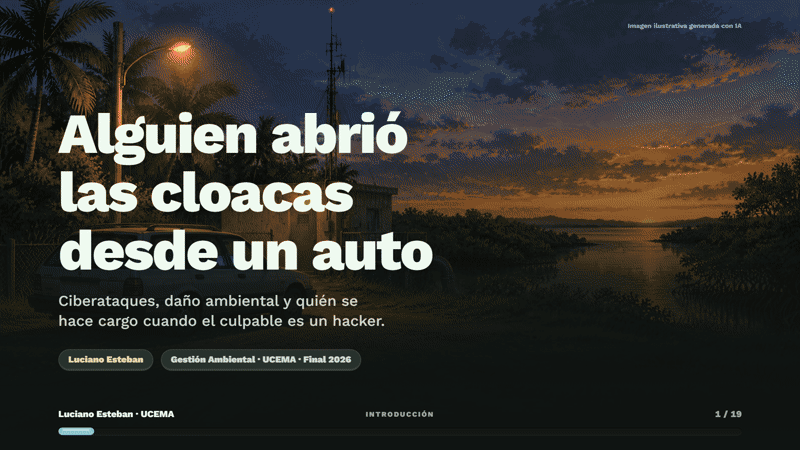
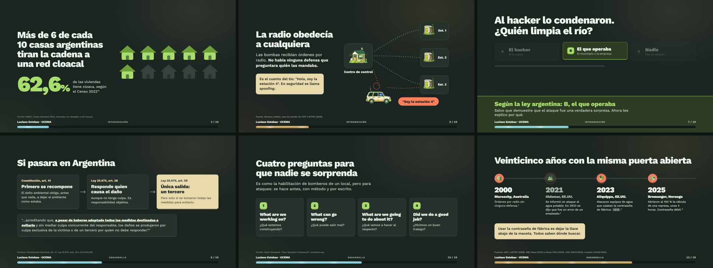

# Alguien abrió las cloacas desde un auto

**Ciberataques, daño ambiental y quién se hace cargo cuando el culpable es un hacker**

Trabajo final de Gestión Ambiental · UCEMA · 2026 · Luciano Esteban

[**Ver la presentación**](https://luciofex.github.io/presentaci-n-2-gestion-ambiental/)

## La idea en una frase

Cuando un hacker causa un daño ambiental, responde el que operaba el sistema, salvo que pruebe que el ataque fue una verdadera sorpresa. Y después de 25 años de ataques parecidos, ya no lo es.

## El caso, en 30 segundos

En el año 2000, en Maroochy (Queensland, Australia), Vitek Boden había ayudado a instalar el sistema que controlaba las bombas de las cloacas. Pidió trabajo en el municipio y no lo tomaron. Entre febrero y abril mandó **46 órdenes** por radio desde su auto, haciéndose pasar por una de las estaciones. Las bombas le obedecían a cualquiera que hablara su idioma.

Resultado: unos **800.000 litros** de líquido cloacal en parques, ríos y el terreno de un hotel. A Boden lo condenaron a dos años de prisión. El río, igual, quedó sucio.

**La pregunta del trabajo:** si eso pasara hoy en Argentina, ¿quién limpia el río?

## El razonamiento, paso a paso

| Paso | Qué dice | De dónde sale |
|---|---|---|
| 1. Primero se recompone | El daño ambiental obliga, antes que nada, a dejar el ambiente como estaba | Constitución Nacional, art. 41 |
| 2. Responde quien causa el daño | Aunque no tenga culpa. Es responsabilidad objetiva | Ley 25.675, art. 28 |
| 3. Una sola salida | Que el daño lo haya causado un tercero y que se hayan tomado "todas las medidas destinadas a evitarlo" | Ley 25.675, art. 29 · CCyC, arts. 1730 y 1731 |
| 4. El puente | Para el derecho, el caso fortuito es algo imprevisible: una sorpresa. Para la ciberseguridad, el threat modeling existe para que nadie se sorprenda | Adam Shostack |
| 5. La prueba del tiempo | Maroochy, Oldsmar, Aliquippa y Noruega muestran que el riesgo ya es conocido. Lo previsible no sirve de excusa | Línea de tiempo, abajo |

## Threat modeling para no técnicos

El threat modeling es como la habilitación de bomberos de un local, pero para ataques: se hace antes, con método y por escrito. Adam Shostack lo resume en cuatro preguntas:

1. **¿Qué estamos construyendo?** (What are we working on?)
2. **¿Qué puede salir mal?** (What can go wrong?)
3. **¿Qué vamos a hacer al respecto?** (What are we going to do about it?)
4. **¿Hicimos un buen trabajo?** (Did we do a good job?)

Aplicado a Maroochy, la segunda pregunta tenía tres respuestas obvias: alguien de afuera podía decir "soy la estación 4" (*spoofing*), podía mandar órdenes alteradas (*tampering*) y un ex contratista seguía sabiendo entrar porque nadie le cortó el acceso.

## No es un problema del 2000

| Año | Dónde | Qué pasó |
|---|---|---|
| 2000 | Maroochy, Australia | Órdenes por radio sin ninguna defensa |
| 2021 | Oldsmar, EE.UU. | Se informó un ataque al agua potable. En 2023 se dijo que fue un error de un empleado, por eso no lo uso como prueba |
| 2023 | Aliquippa, EE.UU. | Atacaron equipos que usaban la contraseña de fábrica: `1111` |
| 2025 | Bremanger, Noruega | Abrieron al 100 % la válvula de una represa durante unas 4 horas. Contraseña débil |

En 2024, la agencia ambiental de Estados Unidos (EPA) informó que **más del 70 %** de los sistemas de agua que inspeccionó no cumplían lo básico de ciberseguridad.

## La conclusión

**Decisión:** autorizar razonablemente la digitalización del agua, con condiciones (criterio de la Corte en "Diaguita de Andalgalá"). Las plantas de agua, cloacas y represas presentan un threat model, igual que presentan una evaluación de impacto ambiental. Proporcional al riesgo, escrito y revisado.

**Opinión personal:** ¿es justo que pague el atacado? Sí, si dejó la puerta abierta. El río no puede esperar a que encuentren al culpable.

**Límites, dichos con honestidad:**
- Las cifras de Maroochy varían según la fuente (de 800 mil litros a "millones").
- No encontré un fallo argentino sobre daño ambiental causado por un ciberataque. Lo que hago es aplicar la ley vigente a un caso nuevo.
- Un threat model no es un salvoconducto. En actividades riesgosas, cumplir las técnicas de prevención no exime (CCyC, art. 1757). Es lo mínimo para poder discutir la eximente.

## Cómo se usa la presentación

| Tecla | Qué hace |
|---|---|
| `→` `AvPág` clic o clicker | Siguiente slide (las animaciones corren solas) |
| `←` `RePág` | Slide anterior |
| `N` | Notas del orador |
| `F` | Pantalla completa |

También anda con swipe en el celular. Para ir a una slide puntual, agregá el número al final del link: `#8`. Con `?all` se muestran todas las animaciones ya terminadas, útil para imprimir o sacar capturas.

## Si querés reusarla para tu presentación

Es un solo `index.html`, sin frameworks ni build. Lo bajás, lo abrís en el navegador y listo.

- Cada slide es un `<section class="slide">`. Copiá una y cambiá el texto.
- Lo que tenga la clase `f` aparece solo, en orden, unos segundos después de entrar a la slide. Con `data-at="6500"` elegís el momento exacto en milisegundos.
- `data-src="..."` en la sección pone la fuente en letra chica abajo de la slide.
- El texto dentro de `
` es lo que ves con la tecla `N`.
- Los colores están arriba de todo, en las variables de `:root`.

Para publicarla gratis: subí el archivo a un repo de GitHub y activá **Settings → Pages**.

## Fuentes

**El caso**
- MITRE ATT&CK for ICS, ["Maroochy Water Breach", campaña C0020](https://attack.mitre.org/campaigns/C0020/)
- Abrams, M. y Weiss, J. (2008). [*Malicious Control System Cyber Security Attack Case Study: Maroochy Water Services, Australia*](https://www.acsac.org/2008/program/case-studies/Abrams.pdf). NIST y MITRE
- The Register (31/10/2001), ["Hacker jailed for revenge sewage attacks"](https://www.theregister.com/2001/10/31/hacker_jailed_for_revenge_sewage/)

**Normas**
- [Constitución Nacional, art. 41](https://servicios.infoleg.gob.ar/infolegInternet/anexos/0-4999/804/norma.htm)
- [Ley 25.675 General del Ambiente](https://servicios.infoleg.gob.ar/infolegInternet/anexos/75000-79999/79980/norma.htm), arts. 4, 22, 28 y 29
- [Código Civil y Comercial](https://servicios.infoleg.gob.ar/infolegInternet/anexos/235000-239999/235975/norma.htm), arts. 1710, 1730, 1731 y 1757
- [Resolución 1523/2019](https://www.argentina.gob.ar/normativa/nacional/norma-328599/texto), infraestructuras críticas (sector hídrico)
- CSJN, "Diaguita de Andalgalá" (2012)

**Threat modeling**
- Adam Shostack, [Threat Modeling y las cuatro preguntas](https://shostack.org/resources/threat-modeling)

**Los otros casos y los datos**
- Oldsmar: [NBC News (2021)](https://www.nbcnews.com/tech/security/florida-near-miss-cybersecurity-worst-case-scenario-n1257091) y [Route Fifty (2023)](https://route-fifty.com/cybersecurity/2023/03/florida-city-water-cyber-incident-allegedly-caused-employee-error/384267)
- Aliquippa: [CISA (28/11/2023)](https://www.cisa.gov/news-events/alerts/2023/11/28/exploitation-unitronics-plcs-used-water-and-wastewater-systems) y [Security Affairs](https://securityaffairs.com/154818/hacktivism/cyber-av3ngers-hacked-municipal-water-authority-of-aliquippa.html)
- Bremanger: [Anadolu (13/08/2025)](https://aa.com.tr/en/europe/norway-security-service-says-pro-russian-hackers-behind-dam-sabotage/3658521) e [iLaks (03/10/2025)](https://ilaks.no/pro-russiske-hackere-apnet-vannkilden-til-postsmoltanlegg-na-har-pst-henlagt-saken/)
- EPA, [alerta de cumplimiento (20/05/2024)](https://industrialcyber.co/utilities-energy-power-water-waste/epa-alerts-drinking-water-systems-on-cybersecurity-vulnerabilities-increasing-enforcement-actions)
- INDEC, Censo 2022, viviendas con desagüe a red cloacal, vía [El Cronista](https://www.cronista.com/economia-politica/nuevos-detalles-del-censo-2022-cuantos-argentinos-alquilan-tienen-cloaca-e-internet)

---

Las ilustraciones y las escenas son imágenes generadas con IA, con fines ilustrativos. Trabajo académico: no es asesoramiento legal.
